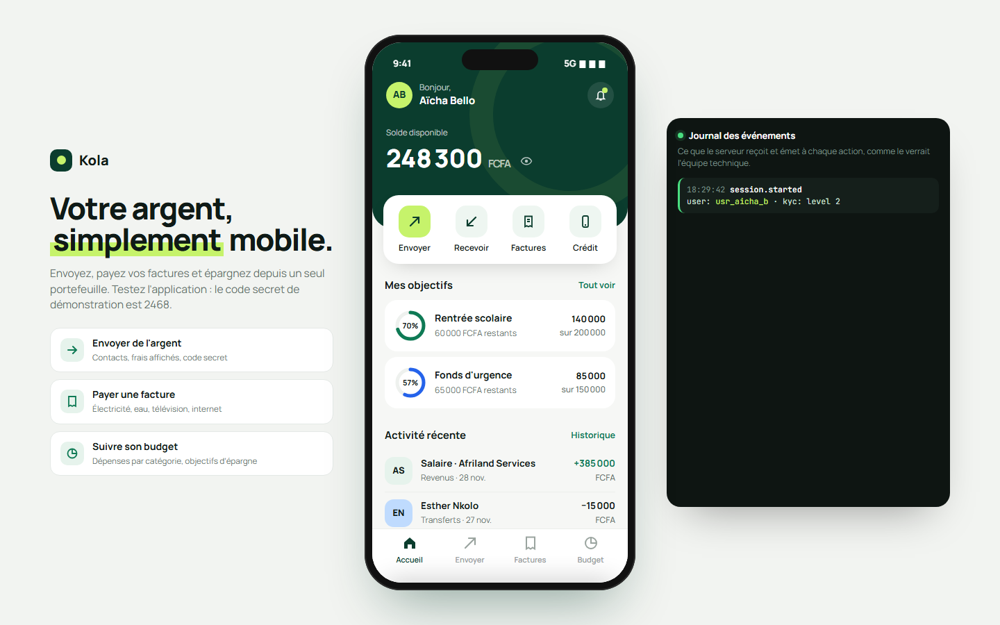
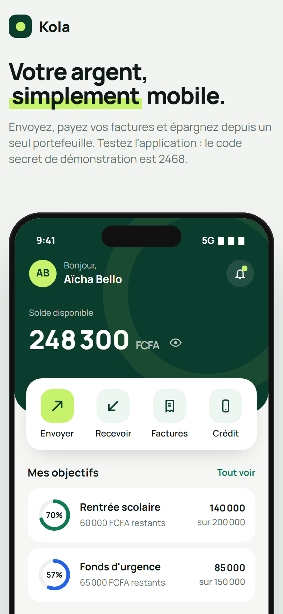

# Kola

**Application de portefeuille Mobile Money** — Prototype haute fidélité d'un portefeuille mobile : solde masquable, envoi d'argent à un contact avec clavier, calcul des frais et contrôle du solde, confirmation par code secret, reçu, paiement de factures avec recherche du contrat, achat de crédit, code QR de réception, budget mensuel par catégorie et objectifs d'épargne. Un journal affiche en parallèle les événements serveur émis par chaque action.

**Démo en ligne : [https://lordlennyx.github.io/kola-wallet-mobile-money/](https://lordlennyx.github.io/kola-wallet-mobile-money/)**

Spot de présentation (30 s) : [media/spot-30s.mp4](https://lordlennyx.github.io/kola-wallet-mobile-money/media/spot-30s.mp4)

## Ce que le projet montre

- Envoi d'argent : contacts, clavier numérique, montants rapides, frais calculés, solde insuffisant détecté
- Confirmation par code secret avec gestion des erreurs et reçu détaillé
- Paiement de factures : choix du service, recherche du contrat, aperçu de la facture
- Achat de crédit, réception par code QR, solde masquable
- Budget mensuel en anneau par catégorie, comparaison avec le mois précédent, objectifs d'épargne
- Journal des événements serveur (transfer.initiated, auth.pin_verified, bill.paid…) en direct

## Réalisation

- **Stack :** HTML, CSS, JavaScript natif, SVG
- **Typographies :** Manrope, JetBrains Mono
- **Évolutions possibles :** application React Native ou Flutter, API d'agrégateur Mobile Money, connexion biométrique, tontines de groupe, détection de fraude

| Bureau | Mobile |
|---|---|
|  |  |

---

Client et contenus fictifs, créés pour la démonstration. Conception, design et développement : **Njundiyimun Béchard** — [github.com/LordLennyx](https://github.com/LordLennyx)
